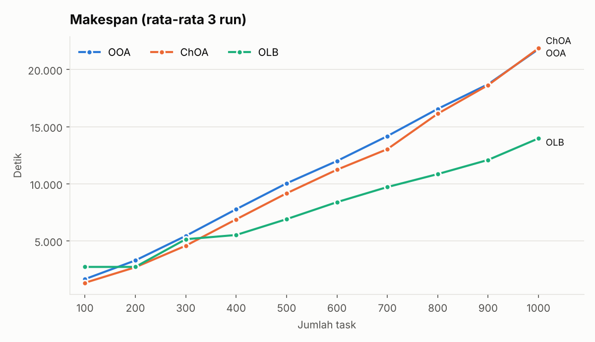
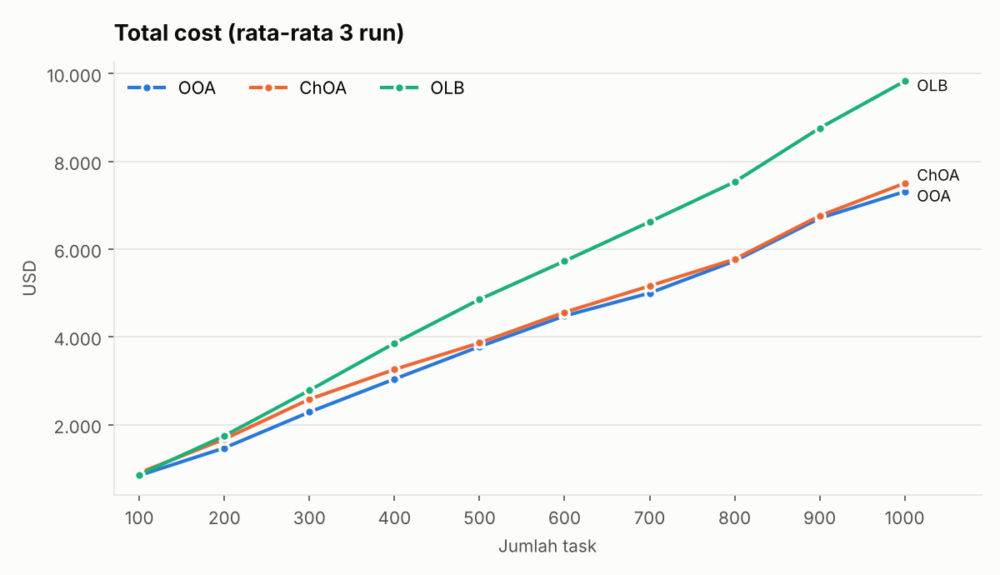
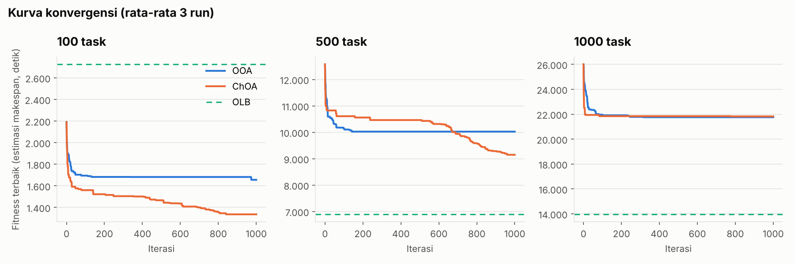
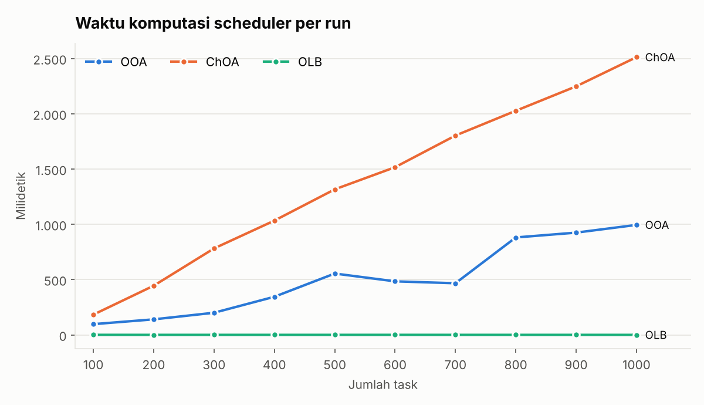
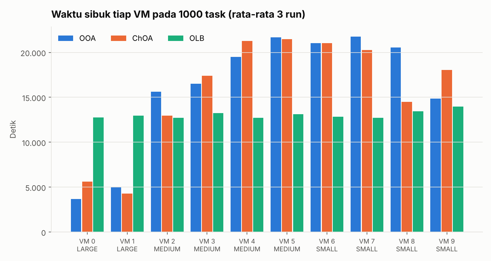

# Hasil Pengujian

Berkas ini dibuat otomatis oleh `analisis/buat_grafik.py` dari CSV di folder `hasil/`.
Pembahasan ada di [README.md](README.md#8-hasil-pengujian).

Skenario: trace-driven, 100 sampai 1.000 task, 3 run per jumlah task, 30 run per algoritma.
OOA dan ChOA memakai populasi awal 100% acak, sesuai paper. Nilai OOA dan ChOA ditulis sebagai
rata-rata ± simpangan baku dari 3 run. OLB tidak diberi simpangan baku karena ketiga run-nya identik.

## 1. Rata-rata 3 run

### 1.1 Makespan (detik)

| Jumlah task | OOA | ChOA | OLB |
| :---: | :---: | :---: | :---: |
| 100 | 1.657,85 ± 174,35 | 1.338,57 ± 53,64 | 2.727,20 |
| 200 | 3.293,77 ± 170,92 | 2.697,74 ± 90,82 | 2.727,76 |
| 300 | 5.441,48 ± 371,20 | 4.580,76 ± 247,77 | 5.150,64 |
| 400 | 7.775,25 ± 452,32 | 6.889,19 ± 251,50 | 5.520,27 |
| 500 | 10.037,26 ± 502,30 | 9.166,93 ± 398,21 | 6.905,91 |
| 600 | 11.995,45 ± 300,56 | 11.231,72 ± 642,75 | 8.394,53 |
| 700 | 14.172,29 ± 326,10 | 13.031,27 ± 874,17 | 9.715,47 |
| 800 | 16.556,49 ± 373,60 | 16.132,30 ± 1.107,59 | 10.849,84 |
| 900 | 18.714,43 ± 434,42 | 18.637,04 ± 1.390,55 | 12.090,53 |
| 1000 | 21.781,68 ± 913,11 | 21.860,72 ± 452,89 | 13.973,89 |

### 1.2 Total cost ($)

| Jumlah task | OOA | ChOA | OLB |
| :---: | :---: | :---: | :---: |
| 100 | 845,69 ± 49,28 | 906,40 ± 20,47 | 862,04 |
| 200 | 1.472,38 ± 48,70 | 1.673,39 ± 53,60 | 1.748,03 |
| 300 | 2.289,41 ± 111,03 | 2.581,89 ± 143,31 | 2.784,07 |
| 400 | 3.041,40 ± 10,44 | 3.260,65 ± 149,02 | 3.858,24 |
| 500 | 3.781,12 ± 295,32 | 3.866,38 ± 163,29 | 4.856,82 |
| 600 | 4.480,01 ± 248,36 | 4.563,52 ± 140,41 | 5.729,49 |
| 700 | 5.000,85 ± 239,73 | 5.162,82 ± 211,54 | 6.622,46 |
| 800 | 5.730,92 ± 94,02 | 5.772,16 ± 284,94 | 7.532,56 |
| 900 | 6.705,55 ± 228,58 | 6.760,45 ± 38,76 | 8.759,76 |
| 1000 | 7.312,80 ± 277,67 | 7.502,84 ± 51,53 | 9.828,52 |

### 1.3 Resource utilization (%)

| Jumlah task | OOA | ChOA | OLB |
| :---: | :---: | :---: | :---: |
| 100 | 75,69 ± 6,06 | 89,69 ± 3,25 | 49,44 |
| 200 | 80,11 ± 2,97 | 90,87 ± 2,19 | 86,59 |
| 300 | 80,52 ± 3,48 | 86,82 ± 2,52 | 73,76 |
| 400 | 77,63 ± 4,84 | 84,66 ± 1,21 | 93,29 |
| 500 | 77,23 ± 1,54 | 83,26 ± 2,33 | 93,81 |
| 600 | 76,05 ± 1,63 | 79,51 ± 4,95 | 91,51 |
| 700 | 75,39 ± 1,86 | 79,67 ± 6,04 | 90,91 |
| 800 | 74,54 ± 2,20 | 74,37 ± 7,44 | 92,64 |
| 900 | 75,27 ± 2,21 | 74,15 ± 6,00 | 95,39 |
| 1000 | 73,62 ± 3,02 | 71,74 ± 2,11 | 93,37 |

### 1.4 Degree of imbalance

| Jumlah task | OOA | ChOA | OLB |
| :---: | :---: | :---: | :---: |
| 100 | 0,9222 ± 0,1272 | 0,3316 ± 0,0914 | 1,2642 |
| 200 | 0,8149 ± 0,1112 | 0,4759 ± 0,1813 | 0,2148 |
| 300 | 0,8811 ± 0,0822 | 0,5317 ± 0,1533 | 0,4118 |
| 400 | 1,0056 ± 0,1046 | 0,8344 ± 0,1887 | 0,0916 |
| 500 | 1,0144 ± 0,1316 | 0,9457 ± 0,1496 | 0,0925 |
| 600 | 1,0092 ± 0,0327 | 0,9159 ± 0,0934 | 0,1241 |
| 700 | 1,0687 ± 0,1130 | 1,0258 ± 0,0597 | 0,1219 |
| 800 | 1,0738 ± 0,0485 | 1,1321 ± 0,1040 | 0,1058 |
| 900 | 1,0227 ± 0,0798 | 1,0878 ± 0,0914 | 0,0336 |
| 1000 | 1,1291 ± 0,1479 | 1,1214 ± 0,0964 | 0,0974 |

## 2. Makespan dibanding OLB

Dihitung dari rata-rata 3 run: `(makespan algoritma − makespan OLB) / makespan OLB × 100%`.
Tanda **+** berarti lebih lama dari OLB, tanda **−** berarti lebih cepat.

| Jumlah task | OOA | ChOA |
| :---: | :---: | :---: |
| 100 | -39,21 % | -50,92 % |
| 200 | +20,75 % | -1,10 % |
| 300 | +5,65 % | -11,06 % |
| 400 | +40,85 % | +24,80 % |
| 500 | +45,34 % | +32,74 % |
| 600 | +42,90 % | +33,80 % |
| 700 | +45,87 % | +34,13 % |
| 800 | +52,60 % | +48,69 % |
| 900 | +54,79 % | +54,15 % |
| 1000 | +55,87 % | +56,44 % |

## 3. Titik awal acak dibanding hasil akhir (estimasi makespan, detik)

"Awal acak" adalah rencana terbaik dari 30 agen acak sebelum iterasi pertama, rata-rata 3 run.
OOA dan ChOA memakai populasi awal yang sama karena seed-nya sama.

| Jumlah task | Awal acak (iterasi 0) | OOA akhir | ChOA akhir | OLB |
| :---: | :---: | :---: | :---: | :---: |
| 100 | 2.190,83 | 1.655,83 | 1.336,00 | 2.727,20 |
| 200 | 4.269,33 | 3.288,67 | 2.692,33 | 2.727,76 |
| 300 | 7.445,00 | 5.435,83 | 4.570,17 | 5.150,64 |
| 400 | 10.147,00 | 7.766,33 | 6.879,50 | 5.520,27 |
| 500 | 12.574,33 | 10.025,33 | 9.149,50 | 6.905,91 |
| 600 | 15.159,33 | 11.981,17 | 11.207,33 | 8.394,53 |
| 700 | 16.877,00 | 14.158,33 | 13.004,83 | 9.715,47 |
| 800 | 19.587,67 | 16.541,33 | 16.102,50 | 10.849,84 |
| 900 | 22.857,00 | 18.691,33 | 18.608,00 | 12.090,53 |
| 1000 | 26.011,00 | 21.761,00 | 21.827,17 | 13.973,89 |

## 4. Porsi beban (MI) per tipe VM

Persentase total MI yang dikerjakan tiap tipe VM, rata-rata 3 run. Baris pertama adalah porsi
kapasitas tiap tipe dari total 10.000 MIPS. Makin dekat ke porsi kapasitas, makin seimbang bebannya.

| Jumlah task | Algoritma | LARGE | MEDIUM | SMALL |
| :---: | :---: | :---: | :---: | :---: |
| | *Porsi kapasitas* | *40 %* | *40 %* | *20 %* |
| 100 | OOA | 31,7 % | 48,7 % | 19,5 % |
| 100 | ChOA | 38,9 % | 42,0 % | 19,1 % |
| 100 | OLB | 35,1 % | 35,3 % | 29,6 % |
| 200 | OOA | 22,4 % | 53,1 % | 24,4 % |
| 200 | ChOA | 34,5 % | 43,0 % | 22,5 % |
| 200 | OLB | 38,8 % | 40,3 % | 20,9 % |
| 300 | OOA | 20,8 % | 51,0 % | 28,2 % |
| 300 | ChOA | 31,2 % | 46,0 % | 22,8 % |
| 300 | OLB | 38,9 % | 39,3 % | 21,8 % |
| 400 | OOA | 17,6 % | 55,6 % | 26,8 % |
| 400 | ChOA | 23,6 % | 50,3 % | 26,1 % |
| 400 | OLB | 39,6 % | 39,7 % | 20,7 % |
| 500 | OOA | 16,5 % | 55,0 % | 28,5 % |
| 500 | ChOA | 18,2 % | 54,2 % | 27,5 % |
| 500 | OLB | 39,2 % | 40,7 % | 20,1 % |
| 600 | OOA | 16,9 % | 54,5 % | 28,6 % |
| 600 | ChOA | 18,2 % | 55,4 % | 26,4 % |
| 600 | OLB | 39,3 % | 39,8 % | 20,8 % |
| 700 | OOA | 14,4 % | 56,4 % | 29,2 % |
| 700 | ChOA | 16,6 % | 56,8 % | 26,6 % |
| 700 | OLB | 39,6 % | 39,7 % | 20,7 % |
| 800 | OOA | 15,0 % | 53,9 % | 31,1 % |
| 800 | ChOA | 15,1 % | 57,8 % | 27,2 % |
| 800 | OLB | 39,3 % | 40,4 % | 20,3 % |
| 900 | OOA | 16,0 % | 53,9 % | 30,1 % |
| 900 | ChOA | 16,3 % | 56,2 % | 27,5 % |
| 900 | OLB | 40,0 % | 40,0 % | 20,0 % |
| 1000 | OOA | 13,4 % | 56,5 % | 30,1 % |
| 1000 | ChOA | 15,2 % | 56,3 % | 28,5 % |
| 1000 | OLB | 39,7 % | 39,9 % | 20,4 % |

## 5. Waktu sibuk tiap VM pada 1.000 task (detik, rata-rata 3 run)

| VM | Tipe | OOA | ChOA | OLB |
| :---: | :---: | :---: | :---: | :---: |
| 0 | LARGE | 3.677,08 | 5.616,80 | 12.774,96 |
| 1 | LARGE | 5.006,65 | 4.272,66 | 12.977,27 |
| 2 | MEDIUM | 15.621,14 | 12.946,56 | 12.698,39 |
| 3 | MEDIUM | 16.530,08 | 17.393,74 | 13.232,15 |
| 4 | MEDIUM | 19.478,06 | 21.254,18 | 12.722,56 |
| 5 | MEDIUM | 21.663,00 | 21.459,61 | 13.133,42 |
| 6 | SMALL | 21.022,11 | 21.021,95 | 12.820,77 |
| 7 | SMALL | 21.770,14 | 20.260,45 | 12.710,43 |
| 8 | SMALL | 20.567,18 | 14.501,28 | 13.432,21 |
| 9 | SMALL | 14.845,12 | 18.049,68 | 13.969,60 |

## 6. Waktu komputasi scheduler (milidetik, rata-rata 3 run)

Waktu yang dipakai algoritma untuk memutuskan pembagian task, sebelum simulasi CloudSim dijalankan.

| Jumlah task | OOA | ChOA | OLB |
| :---: | :---: | :---: | :---: |
| 100 | 97 | 183 | 0,37 |
| 200 | 140 | 445 | 0,09 |
| 300 | 200 | 782 | 0,13 |
| 400 | 345 | 1.034 | 0,13 |
| 500 | 555 | 1.316 | 0,16 |
| 600 | 484 | 1.517 | 0,24 |
| 700 | 467 | 1.803 | 0,15 |
| 800 | 881 | 2.027 | 0,12 |
| 900 | 925 | 2.248 | 0,12 |
| 1000 | 995 | 2.512 | 0,04 |

## 7. Akurasi estimasi makespan

Selisih antara estimasi makespan (fitness) dan makespan hasil CloudSim pada seluruh 90 run:
rata-rata 0,132 %, terbesar 0,263 %.

## 8. Grafik

## 9. Data lengkap per run

### 9.1 OOA

| Jumlah task | Run | Makespan (detik) | Total cost ($) | Resource utilization | Degree of imbalance | Estimasi makespan | Waktu scheduler (ms) |
| :---: | :---: | :---: | :---: | :---: | :---: | :---: | :---: |
| 100 | 1 | 1.644,85 | 802,10 | 78,08 % | 0,8640 | 1.643,00 | 104 |
| 100 | 2 | 1.490,37 | 899,15 | 80,18 % | 0,8345 | 1.488,50 | 87 |
| 100 | 3 | 1.838,34 | 835,80 | 68,80 % | 1,0681 | 1.836,00 | 100 |
| 200 | 1 | 3.111,17 | 1.523,04 | 81,83 % | 0,7248 | 3.105,50 | 156 |
| 200 | 2 | 3.449,93 | 1.425,92 | 76,69 % | 0,9392 | 3.444,50 | 136 |
| 200 | 3 | 3.320,20 | 1.468,18 | 81,82 % | 0,7807 | 3.316,00 | 130 |
| 300 | 1 | 5.805,08 | 2.161,25 | 77,62 % | 0,9624 | 5.800,00 | 202 |
| 300 | 2 | 5.063,12 | 2.356,65 | 84,38 % | 0,8829 | 5.058,00 | 200 |
| 300 | 3 | 5.456,23 | 2.350,34 | 79,55 % | 0,7981 | 5.449,50 | 199 |
| 400 | 1 | 8.063,07 | 3.038,20 | 75,63 % | 0,9762 | 8.056,00 | 270 |
| 400 | 2 | 8.008,79 | 3.032,94 | 74,12 % | 1,1217 | 7.997,00 | 311 |
| 400 | 3 | 7.253,90 | 3.053,06 | 83,16 % | 0,9188 | 7.246,00 | 453 |
| 500 | 1 | 9.837,01 | 3.935,57 | 78,35 % | 0,9539 | 9.827,00 | 542 |
| 500 | 2 | 9.665,97 | 3.967,17 | 77,88 % | 0,9240 | 9.658,00 | 564 |
| 500 | 3 | 10.608,79 | 3.440,60 | 75,47 % | 1,1654 | 10.591,00 | 558 |
| 600 | 1 | 12.277,89 | 4.728,87 | 74,36 % | 0,9744 | 12.266,00 | 655 |
| 600 | 2 | 11.679,57 | 4.478,99 | 76,18 % | 1,0141 | 11.662,50 | 406 |
| 600 | 3 | 12.028,88 | 4.232,15 | 77,61 % | 1,0392 | 12.015,00 | 392 |
| 700 | 1 | 14.540,01 | 5.030,55 | 73,23 % | 1,1094 | 14.525,00 | 457 |
| 700 | 2 | 14.058,64 | 4.747,65 | 76,53 % | 1,1557 | 14.043,00 | 468 |
| 700 | 3 | 13.918,22 | 5.224,34 | 76,39 % | 0,9410 | 13.907,00 | 476 |
| 800 | 1 | 16.614,27 | 5.709,09 | 73,10 % | 1,1278 | 16.598,00 | 867 |
| 800 | 2 | 16.157,37 | 5.649,73 | 77,07 % | 1,0597 | 16.142,00 | 888 |
| 800 | 3 | 16.897,84 | 5.833,93 | 73,44 % | 1,0340 | 16.884,00 | 888 |
| 900 | 1 | 18.634,43 | 6.936,74 | 73,71 % | 0,9715 | 18.603,00 | 978 |
| 900 | 2 | 18.325,57 | 6.700,22 | 77,79 % | 0,9820 | 18.306,00 | 998 |
| 900 | 3 | 19.183,29 | 6.479,68 | 74,31 % | 1,1146 | 19.165,00 | 798 |
| 1000 | 1 | 20.731,14 | 7.628,54 | 76,96 % | 0,9633 | 20.711,00 | 668 |
| 1000 | 2 | 22.384,73 | 7.203,23 | 71,08 % | 1,1765 | 22.364,00 | 1.181 |
| 1000 | 3 | 22.229,16 | 7.106,62 | 72,83 % | 1,2474 | 22.208,00 | 1.135 |

### 9.2 ChOA

| Jumlah task | Run | Makespan (detik) | Total cost ($) | Resource utilization | Degree of imbalance | Estimasi makespan | Waktu scheduler (ms) |
| :---: | :---: | :---: | :---: | :---: | :---: | :---: | :---: |
| 100 | 1 | 1.297,13 | 929,77 | 89,19 % | 0,4054 | 1.294,00 | 205 |
| 100 | 2 | 1.399,16 | 891,65 | 86,73 % | 0,3600 | 1.396,00 | 165 |
| 100 | 3 | 1.319,43 | 897,77 | 93,16 % | 0,2294 | 1.318,00 | 179 |
| 200 | 1 | 2.641,24 | 1.657,40 | 93,24 % | 0,3506 | 2.638,00 | 323 |
| 200 | 2 | 2.802,50 | 1.629,60 | 88,94 % | 0,6838 | 2.796,50 | 496 |
| 200 | 3 | 2.649,47 | 1.733,16 | 90,41 % | 0,3933 | 2.642,50 | 514 |
| 300 | 1 | 4.865,11 | 2.451,05 | 85,48 % | 0,7087 | 4.854,50 | 787 |
| 300 | 2 | 4.411,24 | 2.735,05 | 85,25 % | 0,4421 | 4.401,00 | 773 |
| 300 | 3 | 4.465,92 | 2.559,58 | 89,73 % | 0,4442 | 4.455,00 | 786 |
| 400 | 1 | 6.681,53 | 3.425,33 | 84,08 % | 0,6431 | 6.667,50 | 1.040 |
| 400 | 2 | 7.168,84 | 3.135,10 | 83,85 % | 1,0204 | 7.160,00 | 1.031 |
| 400 | 3 | 6.817,20 | 3.221,53 | 86,04 % | 0,8397 | 6.811,00 | 1.030 |
| 500 | 1 | 8.831,23 | 4.014,89 | 84,96 % | 0,8039 | 8.814,00 | 1.336 |
| 500 | 2 | 9.606,91 | 3.691,51 | 80,61 % | 1,1021 | 9.588,50 | 1.302 |
| 500 | 3 | 9.062,66 | 3.892,73 | 84,22 % | 0,9310 | 9.046,00 | 1.311 |
| 600 | 1 | 10.931,90 | 4.450,34 | 83,64 % | 0,8630 | 10.906,00 | 1.516 |
| 600 | 2 | 11.969,60 | 4.519,56 | 74,02 % | 1,0238 | 11.946,00 | 1.515 |
| 600 | 3 | 10.793,67 | 4.720,65 | 80,87 % | 0,8609 | 10.770,00 | 1.519 |
| 700 | 1 | 13.124,67 | 4.919,08 | 81,65 % | 1,0945 | 13.097,50 | 1.813 |
| 700 | 2 | 12.114,16 | 5.298,58 | 84,47 % | 0,9961 | 12.089,00 | 1.841 |
| 700 | 3 | 13.854,99 | 5.270,79 | 72,89 % | 0,9869 | 13.828,00 | 1.755 |
| 800 | 1 | 17.051,23 | 5.760,31 | 69,60 % | 1,2522 | 17.020,00 | 2.011 |
| 800 | 2 | 16.443,19 | 6.062,84 | 70,57 % | 1,0734 | 16.413,00 | 2.053 |
| 800 | 3 | 14.902,49 | 5.493,34 | 82,94 % | 1,0708 | 14.874,50 | 2.017 |
| 900 | 1 | 17.107,01 | 6.797,60 | 80,99 % | 0,9830 | 17.074,00 | 2.255 |
| 900 | 2 | 18.980,28 | 6.763,51 | 71,70 % | 1,1295 | 18.947,00 | 2.247 |
| 900 | 3 | 19.823,83 | 6.720,25 | 69,76 % | 1,1509 | 19.803,00 | 2.242 |
| 1000 | 1 | 21.627,93 | 7.523,43 | 73,46 % | 1,0425 | 21.607,00 | 2.536 |
| 1000 | 2 | 21.571,57 | 7.540,89 | 72,39 % | 1,0929 | 21.531,00 | 2.509 |
| 1000 | 3 | 22.382,66 | 7.444,20 | 69,38 % | 1,2288 | 22.343,50 | 2.492 |

### 9.3 OLB

| Jumlah task | Run | Makespan (detik) | Total cost ($) | Resource utilization | Degree of imbalance | Estimasi makespan | Waktu scheduler (ms) |
| :---: | :---: | :---: | :---: | :---: | :---: | :---: | :---: |
| 100 | 1 | 2.727,20 | 862,04 | 49,44 % | 1,2642 | 2.726,00 | 1 |
| 100 | 2 | 2.727,20 | 862,04 | 49,44 % | 1,2642 | 2.726,00 | 0 |
| 100 | 3 | 2.727,20 | 862,04 | 49,44 % | 1,2642 | 2.726,00 | 0 |
| 200 | 1 | 2.727,76 | 1.748,03 | 86,59 % | 0,2148 | 2.726,00 | 0 |
| 200 | 2 | 2.727,76 | 1.748,03 | 86,59 % | 0,2148 | 2.726,00 | 0 |
| 200 | 3 | 2.727,76 | 1.748,03 | 86,59 % | 0,2148 | 2.726,00 | 0 |
| 300 | 1 | 5.150,64 | 2.784,07 | 73,76 % | 0,4118 | 5.148,00 | 0 |
| 300 | 2 | 5.150,64 | 2.784,07 | 73,76 % | 0,4118 | 5.148,00 | 0 |
| 300 | 3 | 5.150,64 | 2.784,07 | 73,76 % | 0,4118 | 5.148,00 | 0 |
| 400 | 1 | 5.520,27 | 3.858,24 | 93,29 % | 0,0916 | 5.515,00 | 0 |
| 400 | 2 | 5.520,27 | 3.858,24 | 93,29 % | 0,0916 | 5.515,00 | 0 |
| 400 | 3 | 5.520,27 | 3.858,24 | 93,29 % | 0,0916 | 5.515,00 | 0 |
| 500 | 1 | 6.905,91 | 4.856,82 | 93,81 % | 0,0925 | 6.895,00 | 0 |
| 500 | 2 | 6.905,91 | 4.856,82 | 93,81 % | 0,0925 | 6.895,00 | 0 |
| 500 | 3 | 6.905,91 | 4.856,82 | 93,81 % | 0,0925 | 6.895,00 | 0 |
| 600 | 1 | 8.394,53 | 5.729,49 | 91,51 % | 0,1241 | 8.388,00 | 0 |
| 600 | 2 | 8.394,53 | 5.729,49 | 91,51 % | 0,1241 | 8.388,00 | 0 |
| 600 | 3 | 8.394,53 | 5.729,49 | 91,51 % | 0,1241 | 8.388,00 | 0 |
| 700 | 1 | 9.715,47 | 6.622,46 | 90,91 % | 0,1219 | 9.705,00 | 0 |
| 700 | 2 | 9.715,47 | 6.622,46 | 90,91 % | 0,1219 | 9.705,00 | 0 |
| 700 | 3 | 9.715,47 | 6.622,46 | 90,91 % | 0,1219 | 9.705,00 | 0 |
| 800 | 1 | 10.849,84 | 7.532,56 | 92,64 % | 0,1058 | 10.841,00 | 0 |
| 800 | 2 | 10.849,84 | 7.532,56 | 92,64 % | 0,1058 | 10.841,00 | 0 |
| 800 | 3 | 10.849,84 | 7.532,56 | 92,64 % | 0,1058 | 10.841,00 | 0 |
| 900 | 1 | 12.090,53 | 8.759,76 | 95,39 % | 0,0336 | 12.069,50 | 0 |
| 900 | 2 | 12.090,53 | 8.759,76 | 95,39 % | 0,0336 | 12.069,50 | 0 |
| 900 | 3 | 12.090,53 | 8.759,76 | 95,39 % | 0,0336 | 12.069,50 | 0 |
| 1000 | 1 | 13.973,89 | 9.828,52 | 93,37 % | 0,0974 | 13.963,00 | 0 |
| 1000 | 2 | 13.973,89 | 9.828,52 | 93,37 % | 0,0974 | 13.963,00 | 0 |
| 1000 | 3 | 13.973,89 | 9.828,52 | 93,37 % | 0,0974 | 13.963,00 | 0 |
