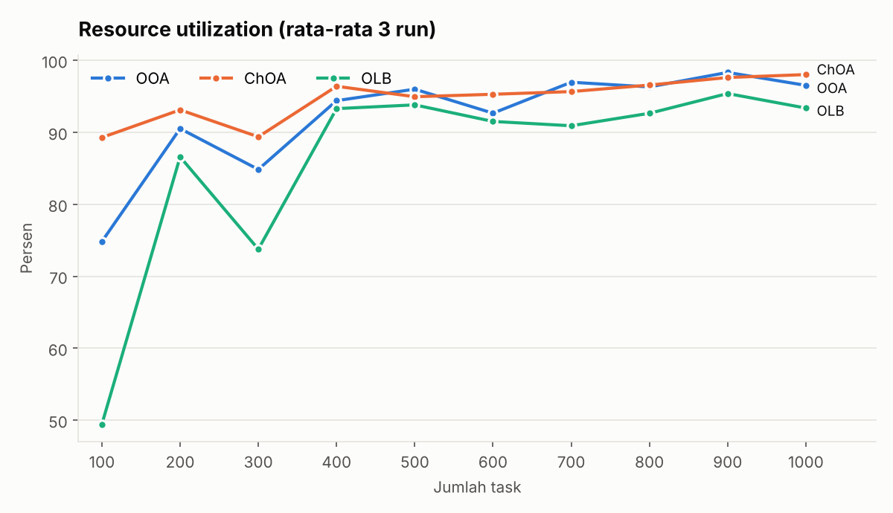
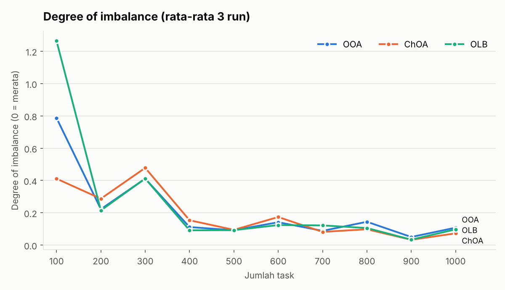
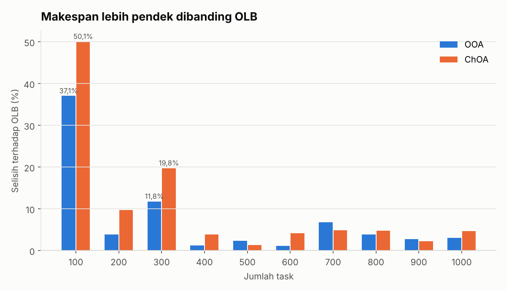

# Hasil Pengujian

Berkas ini dibuat otomatis oleh `analisis/buat_grafik.py` dari CSV di folder `hasil/`.
Pembahasan ada di [README.md](README.md#8-hasil-pengujian).

Skenario: trace-driven, 100 sampai 1.000 task, 3 run per jumlah task, 30 run per algoritma.
Nilai OOA dan ChOA ditulis sebagai rata-rata ± simpangan baku dari 3 run. OLB tidak diberi
simpangan baku karena ketiga run-nya identik.

## 1. Rata-rata 3 run

### 1.1 Makespan (detik)

| Jumlah task | OOA | ChOA | OLB |
| :---: | :---: | :---: | :---: |
| 100 | 1.716,61 ± 101,27 | 1.361,41 ± 61,70 | 2.727,20 |
| 200 | 2.621,70 ± 95,02 | 2.462,37 ± 112,86 | 2.727,76 |
| 300 | 4.543,62 ± 224,27 | 4.133,03 ± 162,25 | 5.150,64 |
| 400 | 5.455,13 ± 59,26 | 5.307,87 ± 19,59 | 5.520,27 |
| 500 | 6.747,30 ± 76,02 | 6.812,42 ± 161,94 | 6.905,91 |
| 600 | 8.299,70 ± 82,13 | 8.045,36 ± 315,92 | 8.394,53 |
| 700 | 9.058,76 ± 67,55 | 9.246,23 ± 406,40 | 9.715,47 |
| 800 | 10.433,76 ± 41,83 | 10.330,08 ± 94,55 | 10.849,84 |
| 900 | 11.758,47 ± 62,24 | 11.822,41 ± 236,32 | 12.090,53 |
| 1000 | 13.541,20 ± 217,01 | 13.326,11 ± 42,64 | 13.973,89 |

### 1.2 Total cost ($)

| Jumlah task | OOA | ChOA | OLB |
| :---: | :---: | :---: | :---: |
| 100 | 817,85 ± 21,34 | 894,91 ± 13,76 | 862,04 |
| 200 | 1.740,61 ± 8,81 | 1.784,49 ± 29,11 | 1.748,03 |
| 300 | 2.727,90 ± 3,33 | 2.765,64 ± 50,40 | 2.784,07 |
| 400 | 3.853,93 ± 6,42 | 3.884,13 ± 28,61 | 3.858,24 |
| 500 | 4.866,19 ± 13,59 | 4.875,57 ± 32,48 | 4.856,82 |
| 600 | 5.722,70 ± 23,05 | 5.702,38 ± 101,24 | 5.729,49 |
| 700 | 6.648,72 ± 36,43 | 6.592,01 ± 27,30 | 6.622,46 |
| 800 | 7.532,10 ± 9,57 | 7.598,39 ± 30,76 | 7.532,56 |
| 900 | 8.729,88 ± 7,07 | 8.748,86 ± 11,95 | 8.759,76 |
| 1000 | 9.806,51 ± 25,21 | 9.790,03 ± 25,66 | 9.828,52 |

### 1.3 Resource utilization (%)

| Jumlah task | OOA | ChOA | OLB |
| :---: | :---: | :---: | :---: |
| 100 | 74,83 ± 6,06 | 89,28 ± 4,08 | 49,44 |
| 200 | 90,51 ± 3,53 | 93,12 ± 6,88 | 86,59 |
| 300 | 84,84 ± 4,87 | 89,37 ± 2,67 | 73,76 |
| 400 | 94,40 ± 1,08 | 96,40 ± 0,69 | 93,29 |
| 500 | 95,99 ± 1,31 | 94,94 ± 1,96 | 93,81 |
| 600 | 92,66 ± 1,04 | 95,28 ± 3,24 | 91,51 |
| 700 | 96,96 ± 0,68 | 95,66 ± 4,11 | 90,91 |
| 800 | 96,31 ± 0,13 | 96,56 ± 0,94 | 92,64 |
| 900 | 98,32 ± 0,65 | 97,61 ± 1,95 | 95,39 |
| 1000 | 96,52 ± 1,28 | 98,02 ± 0,45 | 93,37 |

### 1.4 Degree of imbalance

| Jumlah task | OOA | ChOA | OLB |
| :---: | :---: | :---: | :---: |
| 100 | 0,7871 ± 0,1310 | 0,4112 ± 0,1623 | 1,2642 |
| 200 | 0,2223 ± 0,0502 | 0,2873 ± 0,3087 | 0,2148 |
| 300 | 0,4116 ± 0,0882 | 0,4781 ± 0,2164 | 0,4118 |
| 400 | 0,1117 ± 0,0340 | 0,1538 ± 0,0535 | 0,0916 |
| 500 | 0,0922 ± 0,0194 | 0,0945 ± 0,0034 | 0,0925 |
| 600 | 0,1416 ± 0,0265 | 0,1738 ± 0,1147 | 0,1241 |
| 700 | 0,0882 ± 0,0301 | 0,0818 ± 0,0354 | 0,1219 |
| 800 | 0,1445 ± 0,0543 | 0,0980 ± 0,0087 | 0,1058 |
| 900 | 0,0502 ± 0,0052 | 0,0330 ± 0,0036 | 0,0336 |
| 1000 | 0,1080 ± 0,0372 | 0,0728 ± 0,0150 | 0,0974 |

## 2. Makespan lebih pendek dibanding OLB

Dihitung dari rata-rata 3 run: `(makespan OLB − makespan algoritma) / makespan OLB × 100%`.

| Jumlah task | OOA | ChOA |
| :---: | :---: | :---: |
| 100 | 37,06 % | 50,08 % |
| 200 | 3,89 % | 9,73 % |
| 300 | 11,79 % | 19,76 % |
| 400 | 1,18 % | 3,85 % |
| 500 | 2,30 % | 1,35 % |
| 600 | 1,13 % | 4,16 % |
| 700 | 6,76 % | 4,83 % |
| 800 | 3,83 % | 4,79 % |
| 900 | 2,75 % | 2,22 % |
| 1000 | 3,10 % | 4,64 % |
| **Rata-rata** | **7,38 %** | **10,54 %** |

## 3. Waktu komputasi scheduler (milidetik, rata-rata 3 run)

Waktu yang dipakai algoritma untuk memutuskan pembagian task, sebelum simulasi CloudSim dijalankan.

| Jumlah task | OOA | ChOA | OLB |
| :---: | :---: | :---: | :---: |
| 100 | 85 | 174 | 0,57 |
| 200 | 138 | 327 | 0,09 |
| 300 | 209 | 536 | 0,11 |
| 400 | 265 | 648 | 0,13 |
| 500 | 335 | 806 | 0,18 |
| 600 | 395 | 1.298 | 0,21 |
| 700 | 462 | 1.828 | 0,14 |
| 800 | 529 | 1.873 | 0,13 |
| 900 | 591 | 1.957 | 0,13 |
| 1000 | 666 | 2.349 | 0,03 |

## 4. Akurasi estimasi makespan

Selisih antara estimasi makespan (fitness) dan makespan hasil CloudSim pada seluruh 90 run:
rata-rata 0,117 %, terbesar 0,299 %.

## 5. Grafik

## 6. Data lengkap per run

### 6.1 OOA

| Jumlah task | Run | Makespan (detik) | Total cost ($) | Resource utilization | Degree of imbalance | Estimasi makespan | Waktu scheduler (ms) |
| :---: | :---: | :---: | :---: | :---: | :---: | :---: | :---: |
| 100 | 1 | 1.827,01 | 802,36 | 68,34 % | 0,9352 | 1.825,00 | 106 |
| 100 | 2 | 1.694,78 | 809,01 | 75,80 % | 0,7400 | 1.691,50 | 72 |
| 100 | 3 | 1.628,03 | 842,20 | 80,34 % | 0,6863 | 1.625,50 | 77 |
| 200 | 1 | 2.593,03 | 1.742,93 | 91,52 % | 0,2759 | 2.589,00 | 148 |
| 200 | 2 | 2.544,32 | 1.730,87 | 93,43 % | 0,1763 | 2.540,00 | 138 |
| 200 | 3 | 2.727,76 | 1.748,03 | 86,59 % | 0,2148 | 2.726,00 | 130 |
| 300 | 1 | 4.297,20 | 2.726,00 | 90,29 % | 0,3466 | 4.294,00 | 194 |
| 300 | 2 | 4.597,89 | 2.725,95 | 83,33 % | 0,3763 | 4.594,00 | 218 |
| 300 | 3 | 4.735,77 | 2.731,74 | 80,91 % | 0,5121 | 4.732,00 | 217 |
| 400 | 1 | 5.404,43 | 3.857,00 | 95,45 % | 0,0925 | 5.399,00 | 263 |
| 400 | 2 | 5.440,68 | 3.846,56 | 94,45 % | 0,1510 | 5.437,00 | 270 |
| 400 | 3 | 5.520,27 | 3.858,24 | 93,29 % | 0,0916 | 5.515,00 | 261 |
| 500 | 1 | 6.705,00 | 4.875,66 | 96,60 % | 0,1038 | 6.701,00 | 345 |
| 500 | 2 | 6.835,06 | 4.872,29 | 94,49 % | 0,1031 | 6.831,00 | 329 |
| 500 | 3 | 6.701,85 | 4.850,62 | 96,89 % | 0,0698 | 6.694,00 | 332 |
| 600 | 1 | 8.252,15 | 5.741,58 | 92,93 % | 0,1286 | 8.246,00 | 398 |
| 600 | 2 | 8.394,53 | 5.729,49 | 91,51 % | 0,1241 | 8.388,00 | 394 |
| 600 | 3 | 8.252,41 | 5.697,02 | 93,53 % | 0,1721 | 8.246,00 | 394 |
| 700 | 1 | 9.099,22 | 6.677,03 | 96,22 % | 0,1224 | 9.089,00 | 462 |
| 700 | 2 | 8.980,78 | 6.661,51 | 97,57 % | 0,0654 | 8.972,00 | 461 |
| 700 | 3 | 9.096,29 | 6.607,62 | 97,09 % | 0,0769 | 9.089,00 | 463 |
| 800 | 1 | 10.435,79 | 7.532,10 | 96,41 % | 0,0825 | 10.419,50 | 526 |
| 800 | 2 | 10.390,95 | 7.522,52 | 96,34 % | 0,1832 | 10.375,50 | 536 |
| 800 | 3 | 10.474,53 | 7.541,67 | 96,16 % | 0,1677 | 10.460,50 | 527 |
| 900 | 1 | 11.806,88 | 8.736,80 | 97,83 % | 0,0518 | 11.797,00 | 593 |
| 900 | 2 | 11.780,27 | 8.730,17 | 98,07 % | 0,0544 | 11.745,00 | 596 |
| 900 | 3 | 11.688,26 | 8.722,66 | 99,06 % | 0,0444 | 11.678,00 | 584 |
| 1000 | 1 | 13.294,72 | 9.829,92 | 97,92 % | 0,0726 | 13.274,00 | 659 |
| 1000 | 2 | 13.703,57 | 9.809,80 | 95,41 % | 0,1046 | 13.693,00 | 668 |
| 1000 | 3 | 13.625,30 | 9.779,82 | 96,23 % | 0,1468 | 13.615,00 | 670 |

### 6.2 ChOA

| Jumlah task | Run | Makespan (detik) | Total cost ($) | Resource utilization | Degree of imbalance | Estimasi makespan | Waktu scheduler (ms) |
| :---: | :---: | :---: | :---: | :---: | :---: | :---: | :---: |
| 100 | 1 | 1.379,43 | 887,00 | 90,65 % | 0,4321 | 1.378,00 | 184 |
| 100 | 2 | 1.412,09 | 886,92 | 84,69 % | 0,5620 | 1.409,00 | 173 |
| 100 | 3 | 1.292,71 | 910,80 | 92,50 % | 0,2395 | 1.291,50 | 163 |
| 200 | 1 | 2.591,98 | 1.817,17 | 85,25 % | 0,6371 | 2.587,00 | 330 |
| 200 | 2 | 2.409,32 | 1.775,00 | 96,08 % | 0,1718 | 2.408,00 | 329 |
| 200 | 3 | 2.385,80 | 1.761,31 | 98,02 % | 0,0531 | 2.379,50 | 321 |
| 300 | 1 | 4.313,53 | 2.721,82 | 86,31 % | 0,6725 | 4.306,00 | 548 |
| 300 | 2 | 3.999,32 | 2.820,71 | 90,65 % | 0,2449 | 3.990,00 | 571 |
| 300 | 3 | 4.086,25 | 2.754,38 | 91,17 % | 0,5170 | 4.078,00 | 490 |
| 400 | 1 | 5.295,04 | 3.891,07 | 96,40 % | 0,2033 | 5.284,50 | 655 |
| 400 | 2 | 5.298,14 | 3.852,69 | 97,08 % | 0,0971 | 5.293,00 | 646 |
| 400 | 3 | 5.330,42 | 3.908,63 | 95,71 % | 0,1611 | 5.325,00 | 643 |
| 500 | 1 | 6.905,91 | 4.856,82 | 93,81 % | 0,0925 | 6.895,00 | 809 |
| 500 | 2 | 6.905,91 | 4.856,82 | 93,81 % | 0,0925 | 6.895,00 | 804 |
| 500 | 3 | 6.625,43 | 4.913,08 | 97,21 % | 0,0985 | 6.613,00 | 805 |
| 600 | 1 | 7.759,77 | 5.749,83 | 98,33 % | 0,0521 | 7.745,50 | 963 |
| 600 | 2 | 8.384,71 | 5.586,13 | 91,88 % | 0,2800 | 8.375,00 | 1.324 |
| 600 | 3 | 7.991,60 | 5.771,17 | 95,65 % | 0,1894 | 7.981,00 | 1.608 |
| 700 | 1 | 9.007,10 | 6.583,82 | 98,03 % | 0,0549 | 8.998,00 | 1.837 |
| 700 | 2 | 9.016,12 | 6.569,73 | 98,03 % | 0,0685 | 9.002,00 | 1.837 |
| 700 | 3 | 9.715,47 | 6.622,46 | 90,91 % | 0,1219 | 9.705,00 | 1.812 |
| 800 | 1 | 10.439,16 | 7.565,52 | 95,49 % | 0,1079 | 10.424,00 | 1.307 |
| 800 | 2 | 10.271,64 | 7.603,19 | 97,06 % | 0,0917 | 10.264,00 | 2.179 |
| 800 | 3 | 10.279,43 | 7.626,47 | 97,15 % | 0,0943 | 10.270,00 | 2.132 |
| 900 | 1 | 11.732,27 | 8.736,08 | 98,42 % | 0,0362 | 11.716,50 | 2.404 |
| 900 | 2 | 11.644,43 | 8.750,73 | 99,03 % | 0,0291 | 11.624,00 | 2.017 |
| 900 | 3 | 12.090,53 | 8.759,76 | 95,39 % | 0,0336 | 12.069,50 | 1.450 |
| 1000 | 1 | 13.329,67 | 9.764,46 | 98,15 % | 0,0701 | 13.317,00 | 2.665 |
| 1000 | 2 | 13.281,80 | 9.789,84 | 98,40 % | 0,0593 | 13.268,00 | 2.650 |
| 1000 | 3 | 13.366,86 | 9.815,78 | 97,53 % | 0,0889 | 13.348,50 | 1.731 |

### 6.3 OLB

| Jumlah task | Run | Makespan (detik) | Total cost ($) | Resource utilization | Degree of imbalance | Estimasi makespan | Waktu scheduler (ms) |
| :---: | :---: | :---: | :---: | :---: | :---: | :---: | :---: |
| 100 | 1 | 2.727,20 | 862,04 | 49,44 % | 1,2642 | 2.726,00 | 2 |
| 100 | 2 | 2.727,20 | 862,04 | 49,44 % | 1,2642 | 2.726,00 | 0 |
| 100 | 3 | 2.727,20 | 862,04 | 49,44 % | 1,2642 | 2.726,00 | 0 |
| 200 | 1 | 2.727,76 | 1.748,03 | 86,59 % | 0,2148 | 2.726,00 | 0 |
| 200 | 2 | 2.727,76 | 1.748,03 | 86,59 % | 0,2148 | 2.726,00 | 0 |
| 200 | 3 | 2.727,76 | 1.748,03 | 86,59 % | 0,2148 | 2.726,00 | 0 |
| 300 | 1 | 5.150,64 | 2.784,07 | 73,76 % | 0,4118 | 5.148,00 | 0 |
| 300 | 2 | 5.150,64 | 2.784,07 | 73,76 % | 0,4118 | 5.148,00 | 0 |
| 300 | 3 | 5.150,64 | 2.784,07 | 73,76 % | 0,4118 | 5.148,00 | 0 |
| 400 | 1 | 5.520,27 | 3.858,24 | 93,29 % | 0,0916 | 5.515,00 | 0 |
| 400 | 2 | 5.520,27 | 3.858,24 | 93,29 % | 0,0916 | 5.515,00 | 0 |
| 400 | 3 | 5.520,27 | 3.858,24 | 93,29 % | 0,0916 | 5.515,00 | 0 |
| 500 | 1 | 6.905,91 | 4.856,82 | 93,81 % | 0,0925 | 6.895,00 | 0 |
| 500 | 2 | 6.905,91 | 4.856,82 | 93,81 % | 0,0925 | 6.895,00 | 0 |
| 500 | 3 | 6.905,91 | 4.856,82 | 93,81 % | 0,0925 | 6.895,00 | 0 |
| 600 | 1 | 8.394,53 | 5.729,49 | 91,51 % | 0,1241 | 8.388,00 | 0 |
| 600 | 2 | 8.394,53 | 5.729,49 | 91,51 % | 0,1241 | 8.388,00 | 0 |
| 600 | 3 | 8.394,53 | 5.729,49 | 91,51 % | 0,1241 | 8.388,00 | 0 |
| 700 | 1 | 9.715,47 | 6.622,46 | 90,91 % | 0,1219 | 9.705,00 | 0 |
| 700 | 2 | 9.715,47 | 6.622,46 | 90,91 % | 0,1219 | 9.705,00 | 0 |
| 700 | 3 | 9.715,47 | 6.622,46 | 90,91 % | 0,1219 | 9.705,00 | 0 |
| 800 | 1 | 10.849,84 | 7.532,56 | 92,64 % | 0,1058 | 10.841,00 | 0 |
| 800 | 2 | 10.849,84 | 7.532,56 | 92,64 % | 0,1058 | 10.841,00 | 0 |
| 800 | 3 | 10.849,84 | 7.532,56 | 92,64 % | 0,1058 | 10.841,00 | 0 |
| 900 | 1 | 12.090,53 | 8.759,76 | 95,39 % | 0,0336 | 12.069,50 | 0 |
| 900 | 2 | 12.090,53 | 8.759,76 | 95,39 % | 0,0336 | 12.069,50 | 0 |
| 900 | 3 | 12.090,53 | 8.759,76 | 95,39 % | 0,0336 | 12.069,50 | 0 |
| 1000 | 1 | 13.973,89 | 9.828,52 | 93,37 % | 0,0974 | 13.963,00 | 0 |
| 1000 | 2 | 13.973,89 | 9.828,52 | 93,37 % | 0,0974 | 13.963,00 | 0 |
| 1000 | 3 | 13.973,89 | 9.828,52 | 93,37 % | 0,0974 | 13.963,00 | 0 |
