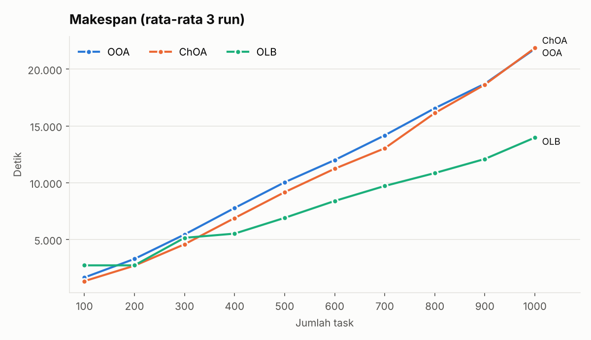
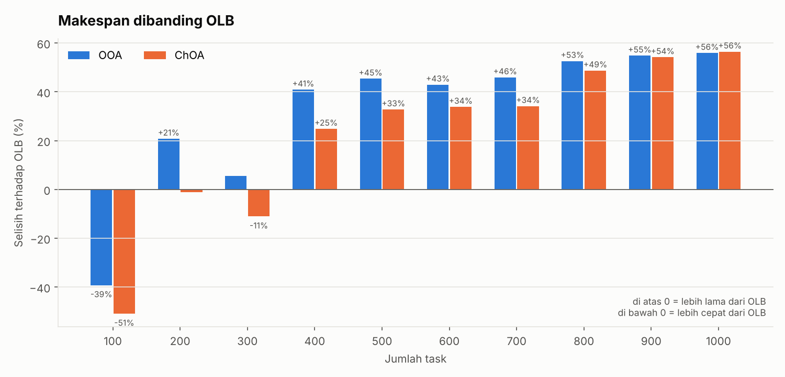
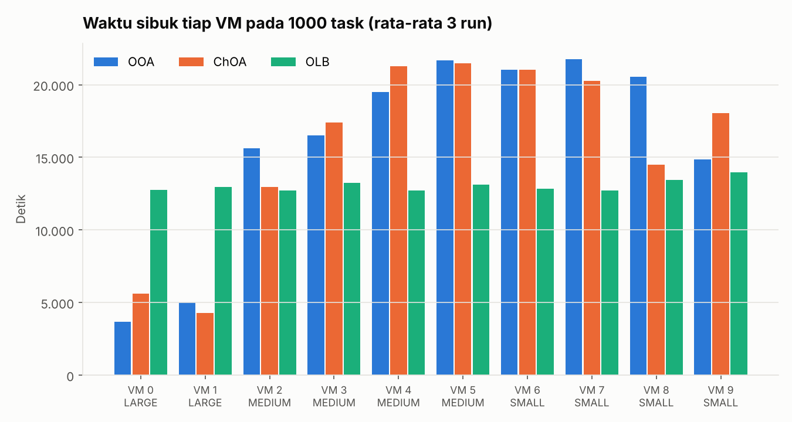
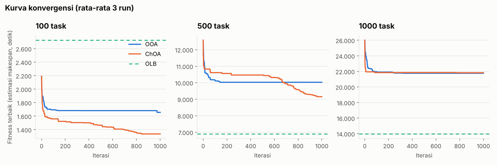
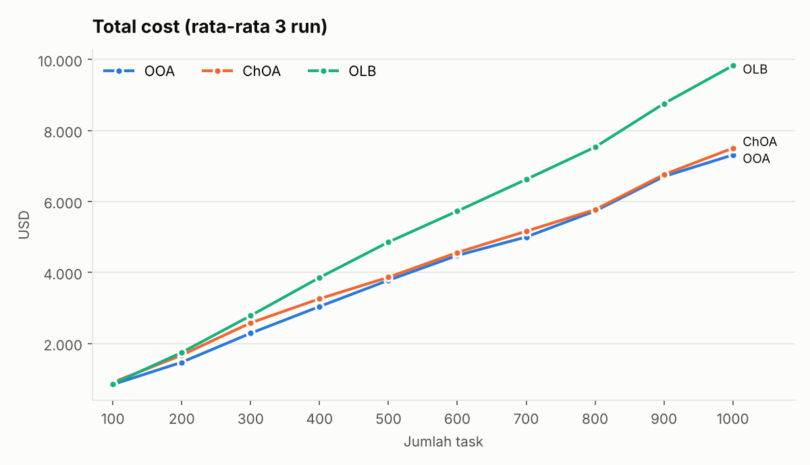
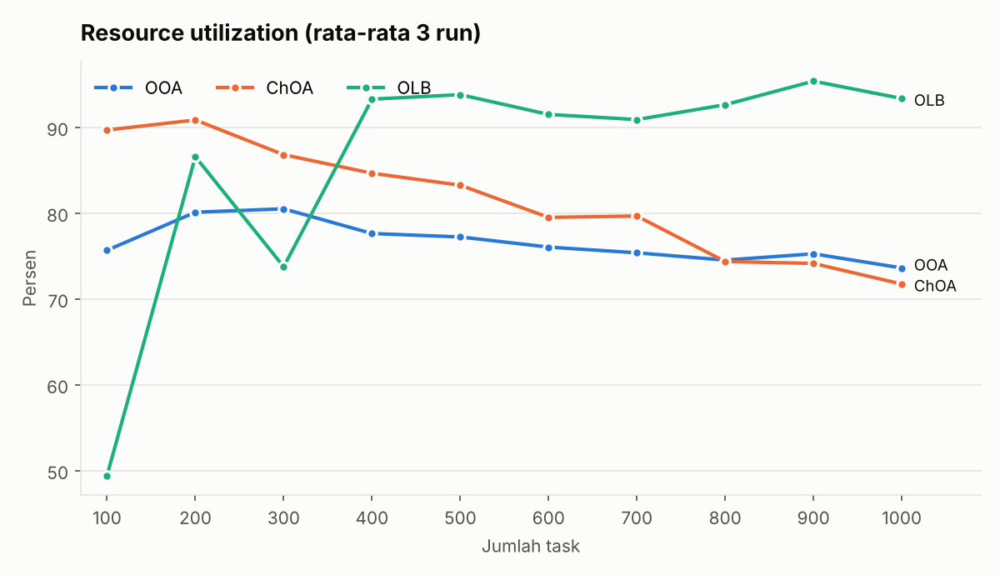
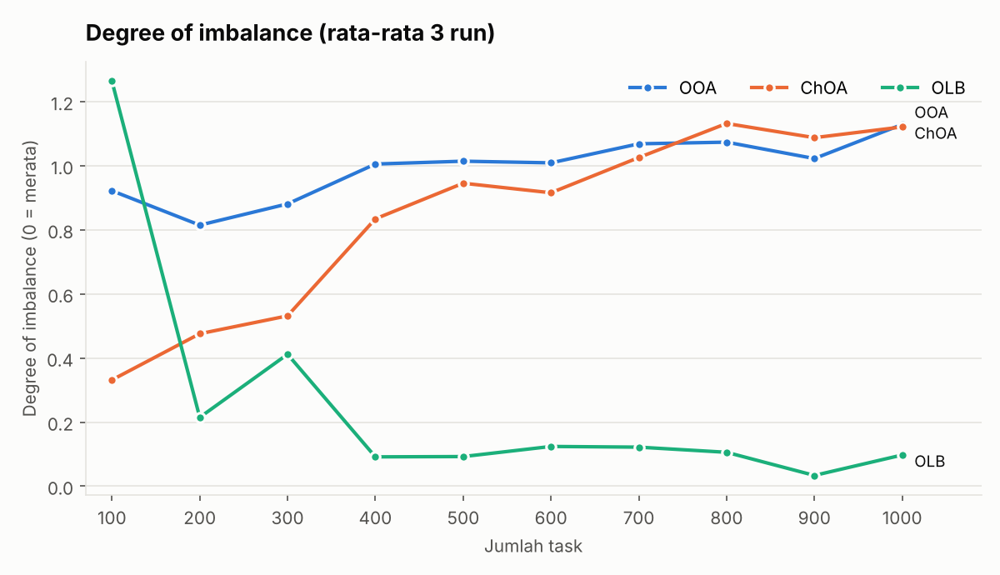
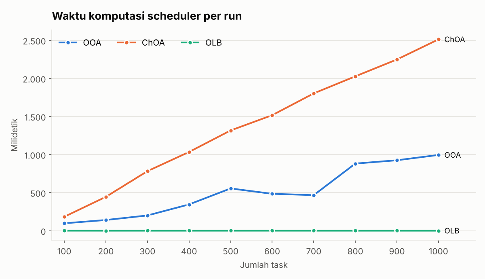

<h1 align="center">Penjadwalan Task CloudSim dengan OOA dan ChOA</h1>
<h3 align="center">Strategi Optimasi Komputasi Awan (SOKA) 2026 · Kelompok 8</h3>

<p align="center">
  
  
  
  
  
  
  
</p>

---

## Anggota Kelompok 8

| No. | Nama | NRP |
| :---: | :--- | :---: |
| 1 | Dimas Muhammad Putra | 5027241076 |
| 2 | Syifa Nurul Alfiah | 5027241019 |
| 3 | Hafiz Ramadhan | 5027241096 |
| 4 | Muhammad Ahsani Taqwiim Rakhman | 5027241099 |
| 5 | Evan Christian Nainggolan | 5027241026 |

---

## Daftar Isi

1. [Ringkasan](#1-ringkasan)
2. [Daftar istilah](#2-daftar-istilah)
3. [Algoritma](#3-algoritma)
4. [Penerapan metaheuristik ke penjadwalan](#4-penerapan-metaheuristik-ke-penjadwalan)
5. [Konfigurasi simulasi](#5-konfigurasi-simulasi)
6. [Skenario pengujian](#6-skenario-pengujian)
7. [Empat metrik evaluasi](#7-empat-metrik-evaluasi)
8. [Hasil pengujian](#8-hasil-pengujian)
9. [Kesimpulan](#9-kesimpulan)
10. [Keterbatasan dan saran](#10-keterbatasan-dan-saran)
11. [Menjalankan program](#11-menjalankan-program)
12. [Struktur project](#12-struktur-project)
13. [Referensi](#13-referensi)

---

## 1. Ringkasan

Di tugas sebelumnya, kami menguji algoritma heuristik **Opportunistic Load Balancing (OLB)** di CloudSim dan di Microsoft Azure. Di repository ini, penjadwalan task di CloudSim dilakukan oleh dua algoritma **metaheuristik**:

1. **Osprey Optimization Algorithm (OOA)**, terinspirasi cara elang tiram berburu ikan.
2. **Chimp Optimization Algorithm (ChOA)**, terinspirasi cara simpanse berburu secara berkelompok.

OLB dipakai sebagai pembanding. Ketiga algoritma diuji pada infrastruktur yang sama (4 host, 10 VM heterogen), dataset yang sama (GoCJ), dan empat metrik yang sama: makespan, total cost, resource utilization, dan degree of imbalance.

Setiap algoritma dijalankan terpisah lewat satu perintah dan menyimpan hasilnya ke CSV, lalu hasil ketiganya dibandingkan.

## 2. Daftar istilah

| Istilah | Arti sederhana |
| :--- | :--- |
| **Task / Cloudlet** | Satu pekerjaan dari dataset GoCJ. Ukurannya dalam **MI** (juta instruksi). Di CloudSim disebut cloudlet. |
| **Host** | Server fisik di dalam datacenter. Tempat VM berjalan. |
| **VM** | Mesin virtual tempat task dikerjakan. Kecepatannya dalam **MIPS** (juta instruksi per detik). |
| **Broker** | "Kurir" di CloudSim yang mengantar task ke VM. Keputusan task ke VM mana dibuat oleh algoritma, broker hanya mengantar. |
| **Heuristik** | Aturan sederhana yang langsung memberi jawaban, misalnya OLB: "kirim ke VM yang paling cepat kosong". |
| **Metaheuristik** | Algoritma yang mencoba banyak kemungkinan jawaban secara bertahap, lalu menyimpan yang terbaik. OOA dan ChOA termasuk di sini. |
| **Agen** | Satu calon jawaban di dalam metaheuristik. Di OOA disebut osprey, di ChOA disebut chimp. Di sini, satu agen = satu rencana pembagian task ke VM. |
| **Populasi** | Kumpulan agen. Di sini berisi 30 agen. |
| **Iterasi** | Satu putaran ketika semua agen bergerak mencari jawaban yang lebih baik. Di sini 1.000 iterasi. |
| **Fitness** | Nilai yang menunjukkan seberapa bagus satu agen. Di sini fitness = estimasi makespan, makin kecil makin baik. |
| **Konvergensi** | Perubahan fitness terbaik dari iterasi ke iterasi. Kurvanya menunjukkan seberapa cepat algoritma menemukan jawaban bagus. |
| **Makespan** | Waktu dari task pertama mulai sampai task **terakhir** selesai. Makin kecil makin baik. |
| **Run** | Satu kali pengujian dengan sejumlah task tertentu. |
| **Seed** | Angka awal pembangkit bilangan acak. Seed yang sama memberi hasil yang sama persis, sehingga pengujian bisa diulang. |

## 3. Algoritma

### 3.1 Osprey Optimization Algorithm (OOA)

OOA meniru osprey yang mencari ikan, menyelam menangkapnya, lalu membawanya ke tempat yang aman untuk dimakan. Setiap iterasi, setiap osprey menjalankan dua fase:

1. **Fase 1, berburu ikan (eksplorasi).** Osprey memilih satu "ikan" secara acak dari osprey lain yang lebih baik darinya (termasuk solusi terbaik), lalu bergerak ke arahnya:
   `x_baru = x + r × (ikan − I × x)`, dengan r acak di [0, 1] dan I acak 1 atau 2.
2. Posisi baru hanya diterima kalau fitness-nya lebih baik.
3. **Fase 2, membawa ikan (eksploitasi).** Osprey bergeser sedikit di sekitar posisinya, dan jarak gesernya makin kecil seiring iterasi:
   `x_baru = x + (lb + r × (ub − lb)) / t`, dengan t = nomor iterasi.
4. Posisi baru hanya diterima kalau fitness-nya lebih baik.
5. Solusi terbaik diperbarui. Langkah 1 sampai 5 diulang sampai iterasi habis.

Setiap osprey dievaluasi **2 kali** per iterasi (sekali per fase).

### 3.2 Chimp Optimization Algorithm (ChOA)

ChOA meniru simpanse yang berburu berkelompok dengan empat peran: **attacker**, **barrier**, **chaser**, dan **driver**. Empat chimp terbaik menjadi pemimpin dengan peran tersebut, dan chimp lain bergerak mengikuti keempatnya.

1. Untuk setiap pemimpin, hitung jarak chimp ke pemimpin: `d = |c × x_pemimpin − m × x|`.
2. Hitung posisi usulan dari setiap pemimpin: `x_k = x_pemimpin − a × d`.
3. Posisi baru = rata-rata keempat usulan: `x_baru = (x1 + x2 + x3 + x4) / 4`.
4. Setelah semua chimp bergerak, keempat pemimpin diperbarui kalau ada chimp yang lebih baik.
5. Langkah 1 sampai 4 diulang sampai iterasi habis.

Keterangan: `f` turun dari 2,5 ke 0 selama iterasi; `a = 2 × f × r1 − f`; `c = 2 × r2`; `m` adalah nilai **chaotic map** (di sini logistic map) yang membuat gerakan simpanse sedikit tak terduga supaya tidak cepat terjebak. Setiap chimp dievaluasi **1 kali** per iterasi.

### 3.3 Opportunistic Load Balancing (OLB, pembanding)

Aturan OLB sama dengan repository CloudSim OLB kelompok 8:

1. Ready time setiap VM diisi 0.
2. Untuk setiap task, pilih VM dengan ready time terkecil.
3. Ready time VM itu ditambah `panjang task / (jumlah core × MIPS)`.

OLB tidak melihat kecepatan VM saat memilih, dan tidak mencoba alternatif lain.

## 4. Penerapan metaheuristik ke penjadwalan

OOA dan ChOA aslinya dibuat untuk mencari titik minimum sebuah fungsi angka. Supaya bisa menjadwalkan task, ada beberapa hal yang perlu ditentukan.

### 4.1 Encoding: agen sebagai rencana pembagian task

Posisi satu agen adalah deretan angka desimal **sepanjang jumlah task**, nilainya di rentang [−5, 5]. Angka ke-i menentukan VM untuk task ke-i:

```text
VM untuk task ke-i = floor(posisi[i] + 5)

contoh posisi : [ 3.7, -4.2, 0.1, -0.6, ... ]
VM            : [   8,    0,   5,    4, ... ]
```

Rentang dibuat simetris di sekitar 0 supaya rumus fase 2 OOA bisa menggeser posisi ke dua arah.

Sesuai paper OOA dan ChOA, populasi awal berisi 30 agen dengan posisi **acak** di rentang tersebut. Tidak ada agen yang diisi solusi dari algoritma lain, jadi OOA dan ChOA mencari pembagian task sepenuhnya dengan caranya sendiri.

### 4.2 Fitness: menilai rencana tanpa menjalankan CloudSim

Selama pencarian, OOA dan ChOA menilai puluhan ribu rencana. Kalau setiap rencana disimulasikan di CloudSim, prosesnya akan sangat lama. Karena itu setiap rencana dinilai dengan **rumus cepat**:

1. Task di setiap VM dikerjakan berurutan sesuai urutan dataset.
2. Setiap task memakai 1 core. VM LARGE punya 2 core, jadi bisa mengerjakan 2 task bersamaan.
3. Waktu satu task = `panjang task / MIPS`.
4. Fitness = waktu selesai core yang paling lama = **estimasi makespan**.

Rencana terbaik baru dijalankan di CloudSim **satu kali** untuk mendapatkan metrik resmi. Kolom `estimasi_makespan` dan `makespan` di CSV hasil bisa dibandingkan untuk menunjukkan bahwa rumus cepat ini akurat.

### 4.3 Alur program

```text
Dataset GoCJ (N baris pertama)
        |
        v
Scheduler (OOA / ChOA / OLB)  -----> menghasilkan: task ke-i -> VM nomor berapa
        |                             (OOA/ChOA: 30 agen x 1.000 iterasi, dinilai dengan fitness)
        v
CloudSim Plus
  Datacenter -> 4 Host -> 10 VM
  Broker mengantar setiap task ke VM sesuai keputusan scheduler
  Simulasi dijalankan
        |
        v
Hitung 4 metrik  ----->  hasil/hasil_<ALG>.csv, konvergensi_<ALG>.csv, vm_<ALG>.csv
```

## 5. Konfigurasi simulasi

Konfigurasi infrastruktur sama dengan repository CloudSim OLB kelompok 8.

### 5.1 Host fisik

Satu datacenter dengan 4 host. Semua host memiliki bandwidth 10.000 Mbps dan storage 1.000.000 MB.

| Host | Grade | Core | MIPS per core | RAM |
| :--- | :--- | :---: | :---: | :---: |
| Host 0, Host 1 | High Performance | 4 | 2.000 | 16 GB |
| Host 2, Host 3 | Standard | 4 | 1.000 | 8 GB |

### 5.2 Mesin virtual

| VM | Tipe | vCPU | MIPS per core | RAM | Tarif per detik |
| :--- | :--- | :---: | :---: | :---: | :---: |
| VM 0 sampai VM 1 | LARGE | 2 | 1.000 | 4 GB | $0,12 |
| VM 2 sampai VM 5 | MEDIUM | 1 | 1.000 | 2 GB | $0,05 |
| VM 6 sampai VM 9 | SMALL | 1 | 500 | 1 GB | $0,02 |

Total kapasitas 10 VM adalah 12 core dan 10.000 MIPS. Setiap VM memakai `CloudletSchedulerSpaceShared`: satu core mengerjakan satu task pada satu waktu, task lain menunggu giliran.

### 5.3 Penempatan VM ke host

Penempatan memakai `GradedVmAllocationPolicy`: VM LARGE dan MEDIUM ke host High Performance, VM SMALL ke host Standard.

| Host | VM yang ditempatkan |
| :--- | :--- |
| Host 0 | VM 0, VM 1 (LARGE) |
| Host 1 | VM 2, VM 3, VM 4, VM 5 (MEDIUM) |
| Host 2 | VM 6, VM 7, VM 8, VM 9 (SMALL) |
| Host 3 | tidak ada VM (cadangan) |

## 6. Skenario pengujian

Pengujian memakai pendekatan **trace-driven**: N task diambil dari N baris pertama `GoCJ_Dataset_1000.csv`, berurutan. Hanya kolom pertama (panjang task dalam MI) yang dipakai.

| Parameter | Nilai |
| :--- | :--- |
| Jumlah task | 100, 200, 300, 400, 500, 600, 700, 800, 900, 1.000 |
| Pengulangan | 3 run per jumlah task, total 30 run per algoritma |
| Algoritma | OOA, ChOA, OLB |
| Populasi OOA dan ChOA | 30 agen |
| Iterasi OOA dan ChOA | 1.000 |
| Seed acak | `1000 × jumlah_task + nomor_run` |

Populasi dan iterasi OOA dan ChOA dibuat sama supaya perbandingannya adil. Karena inputnya trace-driven, OLB memberi hasil yang identik di ketiga run. OOA dan ChOA berbeda antar run karena memakai bilangan acak dengan seed berbeda, sehingga simpangan baku antar run menunjukkan seberapa stabil hasilnya. Seed dibuat tetap, jadi menjalankan ulang program akan memberi angka yang sama persis.

## 7. Empat metrik evaluasi

| Metrik | Rumus | Arti |
| :--- | :--- | :--- |
| **Makespan** (detik) | `waktu selesai task terakhir − waktu mulai task pertama` | Lama seluruh task selesai. Makin kecil makin baik |
| **Total Cost** (USD) | `Σ (waktu eksekusi task × tarif VM yang menjalankannya)` | Biaya pemakaian VM. Makin kecil makin baik |
| **Resource Utilization** (%) | `Σ waktu sibuk semua VM / (10 × makespan) × 100` | Seberapa sibuk VM selama makespan. Makin besar makin baik |
| **Degree of Imbalance** | `(sibuk terlama − sibuk tersingkat) / rata-rata sibuk` | Seberapa timpang beban antar VM. 0 = merata |

**Waktu sibuk** bukan metrik tersendiri, hanya dipakai untuk menghitung Resource Utilization dan Degree of Imbalance:

```text
Waktu sibuk VM j = jumlah waktu eksekusi semua task di VM j / jumlah core VM j
```

Pembagian dengan jumlah core diperlukan karena VM LARGE bisa mengerjakan 2 task bersamaan.

Makespan di sini adalah waktu selesai sebenarnya, mengikuti versi real world. Repository CloudSim OLB yang lama menghitung makespan dari jumlah `actualCpuTime`, sehingga angka OLB di sini jauh lebih kecil daripada di repository lama.

Untuk OOA dan ChOA, dicatat juga **kurva konvergensi** dan **waktu komputasi scheduler** (berapa milidetik algoritma berpikir sebelum simulasi dijalankan).

## 8. Hasil pengujian

Seluruh 90 run (30 per algoritma) selesai tanpa error. Hasilnya identik saat dijalankan ulang di dua komputer berbeda, karena seed acaknya tetap. Tabel lengkap setiap run ada di [HASIL_PENGUJIAN.md](HASIL_PENGUJIAN.md), data mentahnya di folder `hasil/`.

### 8.1 Ringkasan makespan

Rata-rata 3 run, dalam detik. Angka tebal = makespan terkecil di baris itu. Kolom "vs OLB": tanda **−** berarti lebih cepat dari OLB, tanda **+** berarti lebih lama.

| Jumlah task | OOA | ChOA | OLB | OOA vs OLB | ChOA vs OLB |
| :---: | :---: | :---: | :---: | :---: | :---: |
| 100 | 1.657,85 | **1.338,57** | 2.727,20 | −39,21 % | −50,92 % |
| 200 | 3.293,77 | **2.697,74** | 2.727,76 | +20,75 % | −1,10 % |
| 300 | 5.441,48 | **4.580,76** | 5.150,64 | +5,65 % | −11,06 % |
| 400 | 7.775,25 | 6.889,19 | **5.520,27** | +40,85 % | +24,80 % |
| 500 | 10.037,26 | 9.166,93 | **6.905,91** | +45,34 % | +32,74 % |
| 600 | 11.995,45 | 11.231,72 | **8.394,53** | +42,90 % | +33,80 % |
| 700 | 14.172,29 | 13.031,27 | **9.715,47** | +45,87 % | +34,13 % |
| 800 | 16.556,49 | 16.132,30 | **10.849,84** | +52,60 % | +48,69 % |
| 900 | 18.714,43 | 18.637,04 | **12.090,53** | +54,79 % | +54,15 % |
| 1000 | 21.781,68 | 21.860,72 | **13.973,89** | +55,87 % | +56,44 % |





Ringkasnya:

- **Di task sedikit, metaheuristik menang.** Pada 100 task, OOA 39,21% dan ChOA 50,92% lebih cepat dari OLB. ChOA juga masih menang di 200 dan 300 task.
- **Mulai 400 task, OLB menang**, dan selisihnya makin besar seiring bertambahnya task. Pada 1.000 task, OOA dan ChOA sekitar 56% lebih lama dari OLB.

Bagian 8.2 dan 8.3 menjelaskan kenapa bisa begitu, dengan bukti dari hasil pengujian sendiri dan dari paper.

### 8.2 Kenapa metaheuristik menang di task sedikit

Kelemahan OLB adalah tidak melihat panjang task. Pada 100 task, OLB mengirim task ke-91 (900.000 MI, task terpanjang di dataset) ke VM 7, yang bertipe SMALL (500 MIPS). Task itu sendiri butuh 1.800 detik, dan VM 7 baru selesai di detik ke-2.727, sementara sebagian besar VM lain sudah selesai sekitar detik ke-1.100. Hal yang sama terjadi di 200 task.

Kelemahan ini cukup parah sampai-sampai pada 100 task, **rencana acak terbaik dari 30 agen sebelum iterasi pertama (2.190 detik) sudah lebih baik dari OLB (2.727 detik)**. OOA dan ChOA lalu memperbaikinya lagi menjadi 1.658 dan 1.339 detik.

### 8.3 Kenapa metaheuristik kalah di task banyak

#### Bukti dari hasil pengujian

**1. Titik awalnya jauh lebih buruk dari OLB, dan perbaikannya tidak cukup.**

Dengan populasi acak, setiap VM kebagian sekitar 10% task. Padahal kecepatan VM berbeda: VM SMALL hanya setengah kecepatan VM lain, jadi VM SMALL langsung kewalahan. Akibatnya, rencana acak terbaik di awal sudah hampir 2 kali lebih lama dari OLB.

| Jumlah task | Awal acak (iterasi 0) | OOA akhir | ChOA akhir | OLB |
| :---: | :---: | :---: | :---: | :---: |
| 100 | 2.190,83 | 1.655,83 | 1.336,00 | 2.727,20 |
| 500 | 12.574,33 | 10.025,33 | 9.149,50 | 6.905,91 |
| 1000 | 26.011,00 | 21.761,00 | 21.827,17 | 13.973,89 |

Angka di tabel adalah estimasi makespan (fitness), rata-rata 3 run. Pada 1.000 task, OOA dan ChOA berhasil memperbaiki rencana awal sekitar 16%, tetapi masih jauh dari OLB. Data lengkap semua ukuran task ada di bagian 3 [HASIL_PENGUJIAN.md](HASIL_PENGUJIAN.md).

**2. Beban menumpuk di VM nomor tengah, sementara VM LARGE hampir menganggur.**



Pada 1.000 task, OLB membagi beban dengan sangat rata: semua VM sibuk antara 12.698 dan 13.970 detik. OOA dan ChOA tidak. VM 0 dan VM 1 (LARGE, VM tercepat dengan 2 core) hanya sibuk 3.677 sampai 5.617 detik, sedangkan VM 4 sampai VM 7 sibuk lebih dari 19.000 detik.

| Algoritma (1.000 task) | Porsi beban di LARGE | MEDIUM | SMALL |
| :--- | :---: | :---: | :---: |
| *Porsi kapasitas (ideal)* | *40 %* | *40 %* | *20 %* |
| OLB | 39,7 % | 39,9 % | 20,4 % |
| OOA | 13,4 % | 56,5 % | 30,1 % |
| ChOA | 15,2 % | 56,3 % | 28,5 % |

Supaya makespan kecil, beban seharusnya dibagi sebanding kapasitas. OLB hampir pas, sedangkan OOA dan ChOA terlalu sedikit memakai VM LARGE dan terlalu banyak membebani VM MEDIUM dan SMALL.

Penyebab yang paling mungkin ada di encoding (bagian 4.1). VM LARGE adalah nomor 0 dan 1, yaitu posisi −5 sampai −3, di **pinggir** rentang. VM 4 dan 5 ada di posisi sekitar 0, di **tengah**. Rumus gerak kedua algoritma cenderung menarik posisi ke arah tengah:

- Di fase 1 OOA, rumus `x + r × (ikan − I × x)` dengan I = 2 mengecilkan bagian x. Contohnya dengan r = 0,5, hasilnya `0 × x + 0,5 × ikan`: posisi lama hilang dan yang tersisa hanya setengah posisi ikan, yang letaknya lebih dekat ke 0.
- ChOA mengambil **rata-rata** dari 4 usulan posisi, dan rata-rata cenderung jatuh di tengah.

Akibatnya task berkumpul di VM nomor tengah, dan VM LARGE di pinggir jarang dipilih.

**3. Pencarian cepat berhenti membaik.**



Pada kurva 1.000 task, kedua algoritma turun tajam di awal lalu datar di sekitar 21.800 detik, jauh di atas garis OLB (13.974 detik). Pada 500 dan 1.000 task, lebih dari 95% perbaikan OOA terjadi di 100 iterasi pertama. Sisa 900 iterasi hampir tidak menghasilkan apa-apa.

**4. Menambah iterasi tidak menolong.**

Untuk memastikan masalahnya bukan sekadar kurang iterasi, 1.000 task (run 1) dijalankan ulang dengan jumlah iterasi berbeda:

| Iterasi | OOA (detik) | ChOA (detik) |
| :---: | :---: | :---: |
| 500 | 20.731,14 | 21.642,65 |
| 1.000 | 20.731,14 | 21.627,93 |
| 2.000 | 20.731,14 | 21.549,17 |
| 5.000 | 20.731,14 | 21.549,16 |

Hasil OOA **sama persis** dari 500 sampai 5.000 iterasi. ChOA hanya membaik 0,43% walaupun iterasinya dinaikkan 10 kali lipat. Uji ini bisa diulang dengan `.\mvnw.cmd compile exec:java "-Dexec.args=OOA 1000 1" "-Diter=5000"`.

**5. Fitness-nya tidak salah.**

Selisih antara estimasi makespan (fitness) dan makespan hasil CloudSim rata-rata hanya 0,132%, paling besar 0,263%. Artinya OOA dan ChOA memang mengoptimasi hal yang benar. Mereka kalah karena tidak berhasil menemukan pembagian yang bagus, bukan karena penilaiannya keliru.

#### Bukti dari paper

**1. No Free Lunch theorem.** Teorema ini (Wolpert & Macready, 1997) menyatakan bahwa tidak ada satu algoritma optimasi yang paling bagus untuk semua jenis masalah. Algoritma yang unggul di satu jenis masalah bisa kalah di jenis masalah lain. Paper OOA sendiri mengutip teorema ini di bagian pendahuluan sebagai alasan kenapa algoritma baru terus dikembangkan. Jadi metaheuristik kalah dari heuristik sederhana di kondisi tertentu adalah hal yang wajar.

**2. Ukuran masalah jauh di luar yang diuji di paper.** Di masalah ini, jumlah dimensi sama dengan jumlah task.

| | Paper OOA | Pengujian ini |
| :--- | :---: | :---: |
| Jumlah dimensi | 10, 30, 50, 100 | 100 sampai 1.000 |
| Jatah evaluasi fitness | 10.000 × dimensi | 30.030 (ChOA) dan 60.030 (OOA), tetap |
| Evaluasi per dimensi (1.000 task) | 10.000 | 30 (ChOA) dan 60 (OOA) |

Pada 1.000 task, setiap dimensi hanya mendapat 30 sampai 60 evaluasi, jauh di bawah 10.000 seperti di paper. Namun bukti nomor 4 di atas menunjukkan bahwa menambah iterasi saja tidak cukup, jadi ukuran dimensi juga bukan satu-satunya penyebab.

**3. Algoritmanya dirancang untuk angka kontinu, sedangkan penjadwalan itu diskrit.** OOA diuji pada fungsi CEC 2017 dan ChOA pada 30 fungsi benchmark. Semuanya fungsi dengan angka kontinu: menggeser posisi sedikit akan mengubah nilainya sedikit. Di penjadwalan, posisi harus dibulatkan menjadi nomor VM. Menggeser posisi dari 1,9 ke 2,1 tiba-tiba memindahkan task dari VM LARGE ke VM MEDIUM, sedangkan menggeser dari 2,1 ke 2,9 tidak mengubah apa-apa. Nomor VM juga tidak punya makna jarak: VM 1 dan VM 2 "berdekatan" di posisi, padahal tipenya berbeda. Ini membuat arah gerak yang dirancang di paper tidak lagi berarti "mendekati solusi yang lebih baik".

#### Kenapa OLB justru kuat di task banyak

OLB memutuskan task satu per satu dan selalu memilih VM yang paling cepat kosong. Dengan ratusan task, task-task kecil otomatis "mengisi celah" di VM yang sedang longgar, sehingga semua VM sibuk hampir sepanjang waktu. Pada 1.000 task, makespan OLB hanya 7,8% di atas batas bawah teoritis (12.966 detik, yaitu total MI dibagi total kapasitas 10.000 MIPS). Ruang untuk mengalahkan OLB tinggal sedikit, sedangkan OOA dan ChOA mulai dari rencana yang 2 kali lebih lama.

### 8.4 OOA dibanding ChOA

ChOA menghasilkan makespan lebih kecil dari OOA di 9 dari 10 ukuran task. OOA hanya unggul tipis di 1.000 task (21.781,68 berbanding 21.860,72 detik).

Perbedaan paling jelas ada di kurva konvergensi. Perbaikan terakhir OOA umumnya terjadi sebelum iterasi 400, setelah itu datar. ChOA terus membaik sampai iterasi 800 sampai 960 pada 100 dan 500 task, karena nilai `f`-nya turun perlahan dari 2,5 ke 0, sehingga di iterasi akhir chimp mencari di sekitar pemimpin dengan langkah yang makin kecil. Pada 1.000 task, keduanya sama-sama mentok lebih awal: 99,6% perbaikan ChOA terjadi di 100 iterasi pertama.

Soal kestabilan, simpangan baku makespan ChOA lebih kecil di task sedikit (54 detik berbanding 174 detik pada 100 task), tetapi lebih besar di 600 sampai 900 task (sampai 1.391 detik).

### 8.5 Total cost



Mulai 200 task, total cost OOA 15,8 sampai 25,6% lebih murah dari OLB, dan ChOA 4,3 sampai 23,7% lebih murah. Tetapi ini **bukan hasil optimasi**, karena fitness hanya melihat makespan. Ini efek samping dari VM LARGE yang jarang dipakai (bagian 8.3, bukti nomor 2).

Setiap task memakai 1 core, sehingga biaya per 1.000 MI berbeda untuk tiap tipe VM:

| Tipe VM | Kecepatan per task | Tarif per detik | Biaya per 1.000 MI |
| :--- | :---: | :---: | :---: |
| SMALL | 500 MIPS | $0,02 | $0,04 |
| MEDIUM | 1.000 MIPS | $0,05 | $0,05 |
| LARGE | 1.000 MIPS | $0,12 | $0,12 |

VM LARGE adalah yang paling mahal per MI. Karena OOA dan ChOA hanya menaruh sekitar 13 sampai 15% beban di VM LARGE (OLB sekitar 40%), biayanya jadi lebih murah. Jadi OOA dan ChOA lebih murah karena **lebih lambat dan kurang memakai VM terbaik**, bukan karena lebih efisien.

### 8.6 Resource utilization



Pada 100 sampai 300 task, utilisasi OOA dan ChOA lebih tinggi dari OLB (pada 100 task: OLB 49,44%, OOA 75,69%, ChOA 89,69%), karena OLB menyisakan banyak VM menganggur sambil menunggu VM 7.

Mulai 400 task, keadaannya terbalik. OLB tetap di atas 90%, sedangkan OOA dan ChOA turun sampai sekitar 72 sampai 74% pada 1.000 task. Penyebabnya sama: VM LARGE banyak menganggur sementara VM lain masih bekerja.

### 8.7 Degree of imbalance



Pada 100 task, OOA (0,92) dan ChOA (0,33) lebih seimbang dari OLB (1,26). Mulai 200 task, OLB jauh lebih seimbang. Mulai 400 task, OLB berada di 0,03 sampai 0,12, sedangkan OOA dan ChOA sekitar 0,8 sampai 1,1. Grafik ini cerminan langsung dari grafik beban per VM di bagian 8.3.

### 8.8 Waktu komputasi scheduler



OLB memutuskan pembagian task dalam kurang dari 1 milidetik. OOA butuh 97 sampai 995 milidetik per run, ChOA 183 sampai 2.512 milidetik. Angka absolutnya bergantung laptop penguji, tetapi perbandingannya tetap berlaku. Di task banyak, waktu komputasi tambahan ini tidak menghasilkan jadwal yang lebih baik.

ChOA sekitar 2 sampai 4 kali lebih lambat dari OOA walaupun jumlah evaluasi fitness-nya hanya setengah OOA (30.030 berbanding 60.030). Penyebab yang paling mungkin: untuk setiap task, ChOA menghitung gerak terhadap 4 pemimpin sekaligus, sedangkan OOA hanya satu arah per fase. Hal ini belum diukur secara terpisah.

## 9. Kesimpulan

1. **OOA dan ChOA unggul di task sedikit.** Pada 100 task, makespan OOA 39,21% dan ChOA 50,92% lebih cepat dari OLB, karena OLB bisa menaruh task sangat panjang di VM yang lambat. ChOA juga masih unggul di 200 dan 300 task.
2. **Mulai 400 task, OLB unggul**, dan selisihnya makin besar sampai sekitar 56% pada 1.000 task.
3. **Penyebab kekalahan terlihat di data:** mulai 500 task, rencana acak terbaik di awal sudah hampir 2 kali lebih lambat dari OLB, beban menumpuk di VM nomor tengah sementara VM LARGE hampir menganggur, pencarian berhenti membaik setelah sekitar 100 iterasi, dan menambah iterasi sampai 5.000 tidak mengubah hasil OOA sama sekali.
4. **Hasil ini sejalan dengan teori dan paper:** No Free Lunch theorem menyatakan tidak ada algoritma yang selalu terbaik. OOA dan ChOA dirancang dan diuji untuk masalah kontinu dengan maksimal 100 dimensi, sedangkan penjadwalan di sini adalah masalah diskrit dengan sampai 1.000 dimensi.
5. **ChOA lebih baik dari OOA** di 9 dari 10 ukuran task, tetapi komputasinya 2 sampai 4 kali lebih lama.
6. Cost OOA dan ChOA lebih murah di task banyak, tetapi itu efek samping dari jarang memakai VM LARGE, bukan hasil optimasi.

## 10. Keterbatasan dan saran

1. **Encoding sederhana.** Posisi langsung dibulatkan menjadi nomor VM. Encoding lain, misalnya posisi yang menentukan urutan task lalu VM dipilih dengan aturan tertentu, mungkin lebih cocok untuk OOA dan ChOA. Ini belum diuji.
2. **Fitness hanya makespan.** Cost dan degree of imbalance tidak ikut dioptimasi.
3. **Jumlah evaluasi tidak sama.** Populasi dan iterasi dibuat sama (30 dan 1.000), tetapi OOA mengevaluasi fitness 2 kali per agen per iterasi, sehingga total evaluasinya 2 kali lipat ChOA.
4. **Parameter tidak di-tuning.** Populasi 30 dan iterasi 1.000 dipilih tanpa uji sensitivitas, selain uji jumlah iterasi di bagian 8.3.
5. **3 run per ukuran task.** Cukup untuk melihat pola, tetapi terlalu sedikit untuk uji statistik.
6. **Simulasi, bukan cloud nyata.** Semua task tersedia di awal, tidak ada overhead jaringan, dan kecepatan VM selalu tetap.
7. **Saran: pendekatan hybrid.** Menggabungkan metaheuristik dengan heuristik, misalnya mengisi sebagian populasi awal dengan solusi OLB, adalah cara umum untuk mengatasi titik awal yang buruk di masalah besar. Pendekatan ini dibahas terpisah dan tidak termasuk dalam pengujian ini.

## 11. Menjalankan program

### 11.1 Yang perlu diinstal

Cukup **JDK 17 atau lebih baru**. Cek dengan `java -version`, angka versinya harus 17 ke atas.

Maven **tidak perlu diinstal**. Project ini membawa Maven Wrapper (`mvnw.cmd` untuk Windows, `mvnw` untuk Linux/macOS) yang otomatis mengunduh Maven saat pertama kali dijalankan. CloudSim Plus juga diunduh otomatis dari `pom.xml`. Keduanya butuh internet di run pertama saja.

### 11.2 Perintah

Semua perintah dijalankan dari **folder root project** (folder yang berisi `pom.xml`), karena dataset dibaca lewat path relatif.

**Windows (PowerShell atau terminal VS Code):**

```powershell
.\mvnw.cmd compile exec:java "-Dexec.args=OLB"
.\mvnw.cmd compile exec:java "-Dexec.args=OOA"
.\mvnw.cmd compile exec:java "-Dexec.args=CHOA"
```

**Linux / macOS:**

```bash
./mvnw compile exec:java "-Dexec.args=OLB"
```

Di PowerShell, seluruh argumen `-D...` **wajib** dibungkus tanda kutip seperti di atas. Tanpa kutip, PowerShell memotong argumen di tanda titik dan Maven akan error. Kalau Maven sudah terinstal di komputer, `.\mvnw.cmd` boleh diganti `mvn`.

Urutannya bebas dan boleh dijalankan di waktu berbeda. Perkiraan waktu di laptop biasa: OLB beberapa detik, OOA sekitar 1 menit, ChOA sekitar 2 sampai 3 menit. Menjalankan ulang algoritma yang sama akan menimpa file hasilnya.

| Kebutuhan | Perintah (Windows) |
| :--- | :--- |
| Tes cepat (100 task, 1 run) | `.\mvnw.cmd compile exec:java "-Dexec.args=OOA 100 1"` |
| Jumlah task tertentu | `.\mvnw.cmd compile exec:java "-Dexec.args=OOA 100,500,1000 3"` |
| Ubah iterasi atau populasi | `.\mvnw.cmd compile exec:java "-Dexec.args=OOA" "-Diter=2000" "-Dpop=50"` |

Pengaturan bawaan juga bisa diubah langsung di `Config.java`.

### 11.3 Membuat grafik dan HASIL_PENGUJIAN.md

Setelah ketiga algoritma dijalankan, buat ulang grafik dan tabel ringkasan dari folder `hasil/`:

```bash
pip install pandas matplotlib
python analisis/buat_grafik.py
```

Grafik tersimpan di folder `grafik/`, tabel di `HASIL_PENGUJIAN.md`.

### 11.4 File hasil

Semua hasil masuk ke folder `hasil/`:

| File | Isi |
| :--- | :--- |
| `hasil_<ALG>.csv` | 4 metrik setiap run, estimasi makespan, waktu komputasi scheduler, jumlah evaluasi fitness |
| `konvergensi_<ALG>.csv` | Fitness terbaik di setiap iterasi (OOA dan ChOA saja) |
| `vm_<ALG>.csv` | Jumlah task dan waktu sibuk setiap VM di setiap run |

## 12. Struktur project

```text
.
├── pom.xml
├── README.md
├── HASIL_PENGUJIAN.md                    tabel lengkap hasil 90 run (dibuat otomatis)
├── mvnw, mvnw.cmd, .mvn/                 Maven Wrapper (tidak perlu instal Maven)
├── hasil/                                CSV hasil pengujian (hasil_, konvergensi_, vm_)
├── grafik/                               8 grafik PNG
├── analisis/buat_grafik.py               pembuat grafik dan HASIL_PENGUJIAN.md
└── src/main/
    ├── java/
    │   ├── Main.java                      titik masuk, baca argumen, tulis CSV
    │   ├── Config.java                    semua pengaturan eksperimen
    │   ├── VmSpec.java                    spesifikasi 10 VM
    │   ├── Dataset.java                   baca GoCJ (trace-driven)
    │   ├── Scheduler.java                 bentuk umum semua algoritma
    │   ├── Fitness.java                   encoding dan estimasi makespan
    │   ├── OoaScheduler.java              Osprey Optimization Algorithm
    │   ├── ChoaScheduler.java             Chimp Optimization Algorithm
    │   ├── OlbScheduler.java              Opportunistic Load Balancing
    │   ├── SimulationRunner.java          bangun CloudSim, jalankan, hitung metrik
    │   └── GradedVmAllocationPolicy.java  penempatan VM ke host
    └── resources/dataset/GoCJ_Dataset_1000.csv
```

## 13. Referensi

1. Dehghani, M., & Trojovský, P. (2023). Osprey optimization algorithm: A new bio-inspired metaheuristic algorithm for solving engineering optimization problems. *Frontiers in Mechanical Engineering*, 8, 1126450. https://doi.org/10.3389/fmech.2022.1126450
2. Khishe, M., & Mosavi, M. R. (2020). Chimp optimization algorithm. *Expert Systems with Applications*, 149, 113338. https://doi.org/10.1016/j.eswa.2020.113338
3. Wolpert, D. H., & Macready, W. G. (1997). No free lunch theorems for optimization. *IEEE Transactions on Evolutionary Computation*, 1(1), 67–82. https://doi.org/10.1109/4235.585893
4. Hussain, A., & Aleem, M. (2018). GoCJ: Google Cloud Jobs dataset for distributed and cloud computing infrastructures. *Data*, 3(4), 38. https://doi.org/10.3390/data3040038
5. CloudSim Plus. https://cloudsimplus.org
